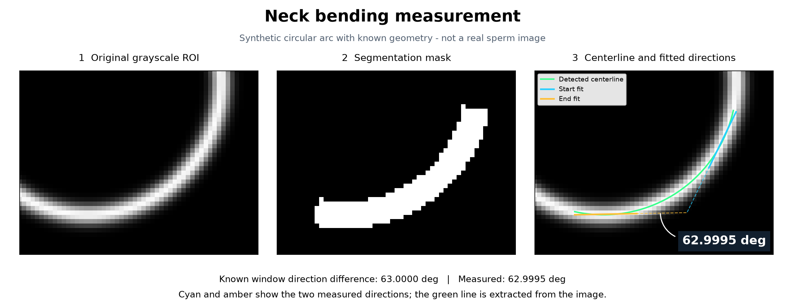
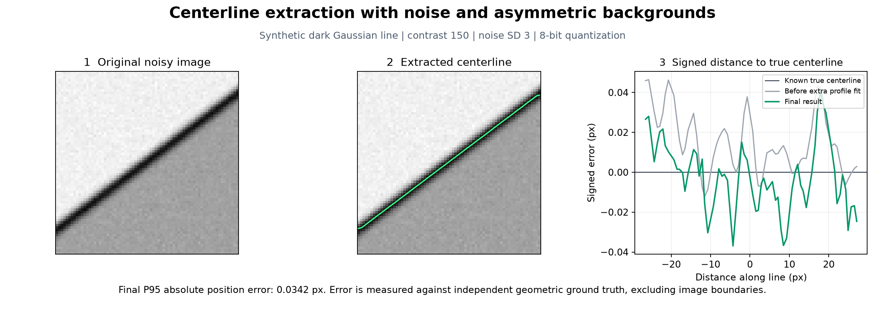
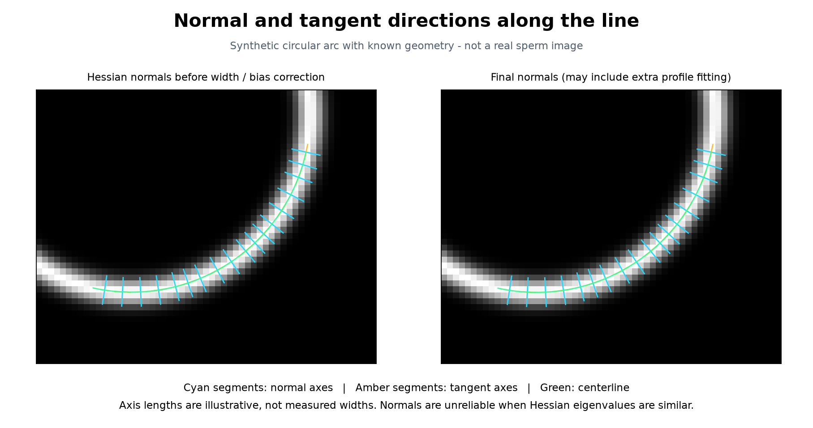

# Steger Python Version

> This is `experiment/mask-only-20261106`. Use `steger.mask_only.MaskOnlyNeckAngleWorker`
> for the strict-mask experiment; existing APIs remain the main control.
> Paired mean latency: 5.93 -> 8.54 ms; final angles: 26 -> 16 of 29 inputs.
> See [experiment and reproduction notes](docs/experiments/mask-only.md).

**English** | [简体中文](README.zh-CN.md)

**Current measurement update:** default bending uses the continuous local geometric
direction range with arc-length windows and auditable terminal checks.
See [measurement rules](docs/robust-neck-angle.md). The literal old C++ policy remains available as `measure_cpp_bending()`.
Published endpoint-fit results below are historical and must be recalculated.

**Stable release: [v1.0.2](https://github.com/SimonHanYANG/Steger-Python-Version/releases/tag/v1.0.2)** · Python package `1.0.2` · [Release notes](docs/releases/v1.0.2.md)

The accepted geometric-angle and optional native/five-process worker are now on
`main`. The previous main tip is preserved as
[`archive/main-before-v1.0.2-20261105`](https://github.com/SimonHanYANG/Steger-Python-Version/tree/archive/main-before-v1.0.2-20261105).
For the measured low-latency configuration, build the optional native module
from source and reuse `NeckAngleWorker(workers=5)`; the universal wheel uses the
Python/SciPy fallback. See [build and integration](docs/low-latency-worker.md).

Native bitwise parity is validated on Windows x64 and Linux x64. On macOS ARM64,
the compiled sampler has last-bit differences from SciPy and has not passed the
same strict checks. Use the Python/SciPy fallback on macOS, without building the
optional extension; the measured 5.59 ms configuration is the validated Windows setup.

Earlier optimization-only comparisons remain in [performance history](reports/performance-followup/README.md).
They predate the new angle definition and are not current-angle or current-runtime results.

A precision-oriented Python implementation of Steger's curvilinear structure detector. It processes grayscale regions of interest (ROIs) and uses segmentation masks to select target structures. No HALCON installation or graphical interface is required.

The implementation follows the Gaussian derivatives, Hessian-based subpixel localization, directional linking, width estimation, and asymmetry bias correction described by Steger (1998). Its parameters and output attributes reference the official HALCON `lines_gauss` documentation.

**Accuracy scope:** This is an independent implementation, not a wrapper around HALCON's native libraries. An additional fit to the original grayscale profile is enabled by default to reduce pixel sampling error. The project owner reviewed the current real-image results and accepted this algorithm as the v1.0 baseline. Synthetic ground-truth validation, quantitative real-image accuracy validation, and agreement with HALCON outputs remain separate evaluations; the latter two have not been established.

## Visual examples

The following public examples use synthetic data with known geometry. The reviewed real-image results remain local.



The green curve is the extracted centerline. Cyan and amber indicate the fitted end directions. The measured angle is **62.9995 degrees**, compared with a known window direction difference of **63.0000 degrees**.



For this asymmetric dark Gaussian line with contrast 150, noise standard deviation 3, and 8-bit quantization, the final P95 position error is **0.0342 px**. The error plot also shows the result before the additional grayscale profile fit; these are outputs of this implementation, not HALCON measurements.

Regenerate these figures with:

```bash
uv run --extra dev python tools/visualize_results.py
```

## Inspect the intermediate process

Steger estimates a normal axis from the Hessian eigenvector with the largest absolute eigenvalue. It then finds a subpixel line point by locating a zero of the first directional derivative along that normal. This calculation precedes contour linking and bias correction.



Cyan segments show normal axes, amber segments show perpendicular tangent axes, and green shows the centerline. Their display lengths are fixed, not measured widths. These are synthetic examples. The [complete recorded report](reports/process/circular-neck/README.md) also includes derivative maps, eigenvalues, candidate selection, and a single-point inspection with the actual Hessian, gradient, and subpixel offset.

Generate the same report for an ROI and mask:

```bash
uv run --extra visualization steger detect roi.tif --mask neck_mask.png \
  --sigma 1.5 --low 3 --high 8 --polarity dark --model gaussian \
  --no-complete-junctions --output results/result.json --process-dir results/process
```

Add `--inspect-point ROW COL` to inspect the nearest located candidate. The report saves lossless arrays in `process.npz` as well as figures. In Python, use `lines_gauss(..., return_trace=True)` followed by `save_process_report` from `steger.visualization`. Recording is optional and tested to preserve detector outputs exactly. See [the algorithm and process guide](docs/steger-process.md).

## Batch analysis of paired neck images

For original 8-bit PNG ROIs named `sample.png` with aligned `sample_mask.png` files:

```bash
uv run --extra visualization python tools/analyze_necks.py neck_mask \
  --output reports/neck-analysis/results
```

The local report includes `index.html`, `angles.csv`, measurement overlays, intermediate process figures, sensitivity plots and `visualizations.zip`. The script checks bright and dark lines at five smoothing strengths, with three larger strengths when needed. Selection uses extent and a reference strength, not angle magnitude. Bending is the range of continuous local fitted directions throughout the valid centerline; straight is zero.

Incomplete or short centerlines receive no full-neck angle; a local diagnostic value stays separate. Interior fitted windows preserve S-shaped bending. Coverage, terminal consistency and sensitivity checks are screening rules, not validated error bounds. Width correction and extra profile fitting remain disabled for this batch policy. Real inputs and their local reports stay excluded from Git.

To measure computation time on an existing local batch, with all input decoding and disk I/O outside the timers:

```bash
uv run --extra visualization python tools/benchmark_neck_runtime.py
```

The benchmark verifies saved angles and statuses, warms the functions, and separately measures angle calculation from resident contours, one fixed-parameter ROI-to-angle run, and the automatic search with quality checks. It exports mean/median/P95 timings, per-image summaries, raw timing samples, and machine/library details to `reports/neck-analysis/runtime/`. Diagnostic-only images are excluded from the angle-only statistics. These timings depend on the machine and input data.

For the deployment boundary where a persistent angle worker receives only raw in-memory ROI and mask arrays, run:

```bash
uv run --extra visualization python tools/benchmark_roi_worker.py
```

This includes RGB conversion, mask processing, Steger extraction, contour selection, and angle calculation inside one worker thread. The adaptive mode reproduces the batch quality/search behavior without cached per-image parameters or contour indices. A separate fixed-global-scale mode reports speed, returned-angle counts, and differences from the adaptive results. Processing time and submit-to-result latency are reported separately in `reports/neck-analysis/worker-runtime/`; segmentation and simultaneous segmentation load are excluded.

## Optional low-latency deployment

Local optimization adds an optional float64 Cython interpolation/Newton module
and `steger.worker.NeckAngleWorker`: five persistent CPU processes evaluate the
existing independent scales using one shared ROI/mask workspace. All search,
fitting and quality rules remain. This consumes different CPU resources from
serial `measure_neck()`; build and warm the optional module first. Mean latency
is not a per-request bound. See [build, validation and integration notes](docs/low-latency-worker.md).

## Installation

The project uses uv and Python 3.12:

```bash
uv sync --extra dev
uv run steger --help
```

Runtime dependencies are NumPy, SciPy, and Pillow. Development checks additionally use pytest. Dependencies are pinned in `uv.lock`. Localization, convolution, and fitting use `float64`; input intensities are not automatically normalized, and pixel dimensions are preserved.

## Python API

For the adaptive neck policy used by the real-image batch, pass resident arrays
directly; no visualization dependency is needed:

```python
from steger import measure_neck

result = measure_neck(roi, mask)
print(result["angle_deg"], result["status"])
```

An insufficient or missing segment returns `angle_deg=None`. Detected segments
also include fit, sensitivity and quality diagnostics. See [the worker API](docs/performance.md).

For general detector parameters and a confirmed single contour:

```python
from steger import lines_gauss, measure_bending
from steger.io import read_image, write_json

image = read_image("roi.tif")
mask = read_image("neck_mask.png", mask=True)

result = lines_gauss(
    image,
    sigma=1.5,
    low=3.0,
    high=8.0,
    light_dark="dark",      # Use dark for a neck darker than its background; otherwise light.
    extract_width=True,
    line_model="gaussian",  # Choose from the observed profile; not all microscopy images are Gaussian.
    complete_junctions=False,
    mask=mask,
)

write_json("result.json", result.to_dict())

# Measure a single confirmed neck contour. Inspect the overlay before selecting
# among multiple contours; do not join unrelated contours automatically.
if len(result.contours) == 1:
    neck = result.contours[0]
    measurement = measure_bending(neck)
    print(measurement.angle_deg)
```

These example parameters are not universal settings for sperm images. For intensities in `[0,1]`, adjust the thresholds accordingly; do not reuse `Low/High` values intended for `[0,255]` without rescaling them.

## Command line

```bash
uv run steger detect roi.tif --mask neck_mask.png \
  --sigma 1.5 --low 3 --high 8 --polarity dark --model gaussian \
  --no-complete-junctions --output result.json --overlay overlay.png
```

Detect and measure a single neck:

```bash
uv run steger detect roi.tif --mask neck_mask.png \
  --sigma 1.5 --low 3 --high 8 --polarity dark --model gaussian \
  --no-complete-junctions --measure-neck --output neck.json --overlay neck.png
```

Inputs include Pillow-readable images such as PNG/TIFF and `.npy` arrays. RGB images are explicitly converted to luminance by the I/O layer; the `lines_gauss` API accepts single-channel images only; `measure_neck` also accepts RGB(A) arrays. The original intensity range is preserved for 16-bit and floating-point grayscale inputs. Masks must match the ROI's dimensions and coordinates; no automatic resizing or registration is performed.

**The mask limits candidate centerline locations without setting the original image outside the mask to black.** Convolution and profile fitting retain the surrounding grayscale data to avoid artificial boundaries affecting subpixel measurements. Contrast adjustment in overlays is for display only.

## Implemented features

| Feature | Implementation |
|---|---|
| Bright and dark lines | Polarity selection using the Hessian eigenvalue with the largest absolute magnitude |
| Gaussian derivatives | Separable, integrated Gaussian kernels from the paper, preserving derivative amplitudes |
| Subpixel localization | Taylor localization with optional Newton refinement, enabled by default to handle ridges between pixels |
| Hysteresis linking | Direction constraints, strong seeds, and weak continuation; closed loops and junction topology are retained |
| Line width | Subpixel searches for gradient maxima on both sides of the normal; missing widths are interpolated along arclength |
| Asymmetry correction | Continuous `bar-shaped`, `parabolic`, and `gaussian` models with numerical bias inversion |
| Accuracy refinement | Optional pixel-area-integrated profile fitting to the original grayscale data |
| Junction completion | Conservative endpoint extension and target contour splitting; inferred points are explicitly flagged |
| Neck bending | Orthogonal line fits within fixed arclength windows; a straight neck measures 0 degrees |
| Accuracy validation | Independent continuous geometric image generation, error reports, and regression tests |

Contours contain `points` (row, column), right-facing `normals` relative to traversal, `response`, `width_left`, and `width_right`. When correction is enabled, they also contain `asymmetry` and `contrast`. Following the HALCON documentation, the `angle` attribute is measured counterclockwise from the positive row axis, in radians. **It describes the normal direction, not the bending angle.**

`width_left/right` are half-widths. For the Gaussian model, the width parameter is its standard deviation, not FWHM. For the parabolic and bar-shaped models, it is the half-support width. Convert to a consistent width definition before comparing different models.

## Quality flags

Inspect quality indicators alongside the coordinates and angles:

- `width_measured` / `width_interpolated`: whether widths came from observations or interpolation.
- `correction_valid` / `correction_residual`: whether continuous bias inversion succeeded.
- `profile_fit_valid` / `profile_fit_rms` / `profile_fit_condition`: whether fitting to the original grayscale data passed its checks.
- `junction_completed`: whether a point was inferred by junction completion; inferred points must not be treated as observations when measuring angles.
- `steger_row/col` and `steger_width_left/right`: corrected results before the additional refinement, retained for inspection.

If correction or fitting fails, the preceding available result is retained and the failure is flagged. Undefined numeric values are written as `null` in JSON.

## Accuracy tests and reports

```bash
uv run --extra dev pytest -q
uv run python tools/benchmark.py --output reports/accuracy.json
uv run --extra dev python tools/summarize_benchmark.py reports/accuracy.json
```

The full benchmark contains 84 straight-line cases and one circular arc. It covers three profile models, multiple widths and orientations, non-integer shifts, symmetric and asymmetric backgrounds, bright and dark lines, 8-bit quantization, and seeded random noise. Images are generated by integrating independent continuous models over pixel areas, rather than treating thresholded drawings as subpixel ground truth. Pixel areas are computed exactly for bar-shaped profiles; other profiles use Gauss-Legendre quadrature.

Predeclared acceptance criteria:

| Sample conditions | Centerline error P95 | Half-width error P95 | Original grayscale fit acceptance |
|---|---:|---:|---:|
| Noiseless, matching model | <= 0.01 px | <= 0.025 px | >= 95% |
| Contrast 150, noise standard deviation 1, 8-bit quantization | <= 0.08 px | <= 0.12 px | >= 95% |
| Contrast 150, noise standard deviation 3, 8-bit quantization | <= 0.20 px | <= 0.30 px | >= 95% |
| Circular arc of a specified radius | Radial error P95 <= 0.01 px | Direction-difference error between the two measurement windows <= 0.1 degrees | Reported separately |

Every case is retained, including detection failures, errors before and after refinement, fit acceptance, and execution time. See the [readable summary](reports/accuracy-summary.md) and [complete numeric report](reports/accuracy.json). The report records the implementation source files' SHA-256 hash so the tested code can be identified. These criteria apply to the specified synthetic conditions, not to arbitrary microscopy images.

## Running closer to the original paper

```python
result = lines_gauss(
    image, sigma=1.5, low=3, high=8,
    profile_refinement=False,  # Disable the additional fit to original grayscale data.
    refine=False,              # Use the paper's single Taylor localization step.
)
```

This mode is not a bitwise clone of HALCON. Numerical inversion, edge interpolation, junction completion, and boundary handling have independent implementation details. The default mode prioritizes reducing measured localization errors rather than reproducing undocumented HALCON internals.

## Optional HALCON comparison

HALCON is not required to run this project. If reference outputs become available, the standalone `tools/export_halcon.py` script can be run on a licensed Windows/Linux installation, followed by:

```bash
uv run steger compare candidate.json reference.json --output comparison.json
```

Comparison uses bidirectional point-to-segment distances so differences in contour sampling spacing are not mistaken for localization errors. Coverage is also reported so a short, accurately detected fragment cannot stand in for the complete target. Passing the geometry comparison does not establish agreement in every attribute or in topology.

## Neck bending angle definition

Validate terminal geometry and fit 20%-arclength windows throughout the valid centerline's 5–95% interval. Align traversal directions, unwrap angles and report their maximum minus minimum, with straight measuring zero. Outputs include excluded original indices, local direction windows, residuals and quality flags.

Interior windows retain S-shaped bending that endpoint differences can cancel. The measurement is a local direction range, not total absolute turning. Short windows, inadequate trusted coverage, closed contours and inferred junction points prevent a full measurement. Earlier methods remain explicit comparison APIs: `measure_end_direction_bending()` and `measure_cpp_bending()`.

## References and scope

- [HALCON 24.11 `lines_gauss` documentation](https://www.mvtec.com/doc/halcon/2411/en/lines_gauss.html)
- [HALCON `get_contour_attrib_xld` attribute definitions](https://www.mvtec.com/doc/halcon/2411/en/get_contour_attrib_xld.html)
- [HALCON `derivate_gauss` documentation](https://www.mvtec.com/doc/halcon/2411/en/derivate_gauss.html)
- C. Steger, *An Unbiased Detector of Curvilinear Structures*, TPAMI 20(2):113-125, 1998. [DOI](https://doi.org/10.1109/34.659930)
- C. Steger, *Unbiased extraction of lines with parabolic and Gaussian profiles*, CVIU 117(2):97-112, 2013. [DOI](https://doi.org/10.1016/j.cviu.2012.08.007)

See the [compatibility and accuracy notes (Chinese)](docs/accuracy-and-compatibility.md) for detailed mappings and known limitations.
