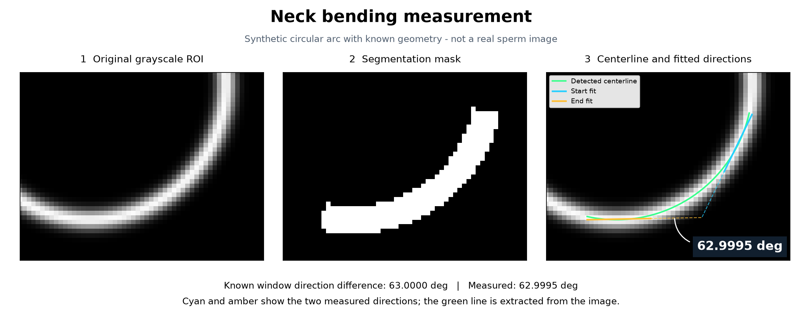
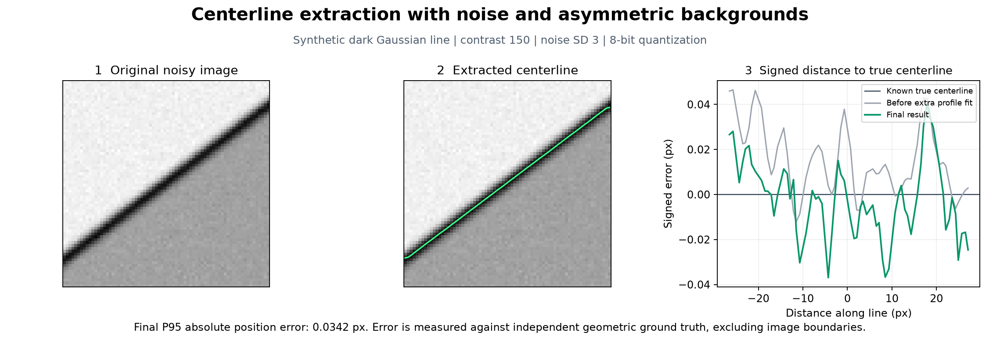
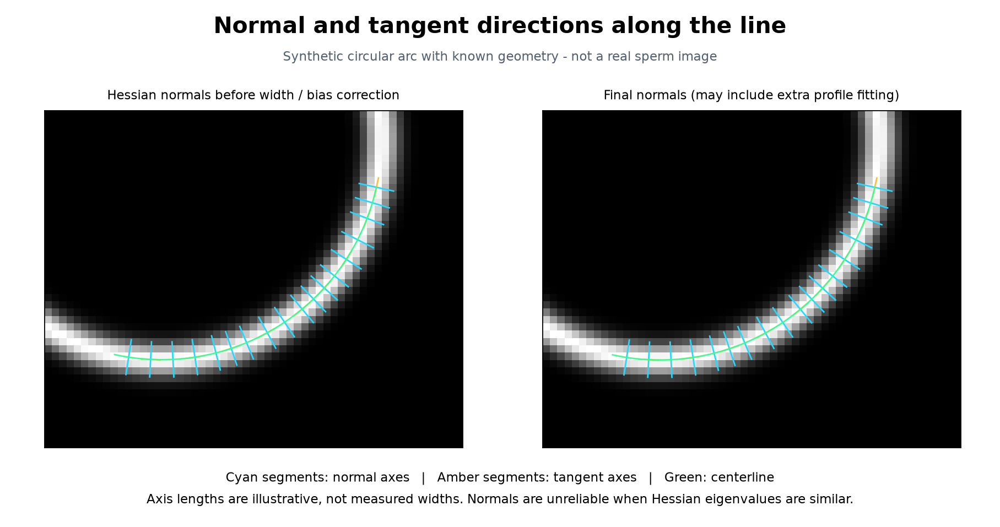

# Steger Python Version

[English](README.md) | **简体中文**

以定位和测量精度为优先的 Python Steger 曲线提取实现，可直接处理灰度 ROI，并用分割 mask 筛选目标。不需要 HALCON、不提供 UI。

基于 Steger 1998 年论文的高斯导数、Hessian 亚像素定位、方向连接、线宽估计和不对称偏差校正；参照 HALCON `lines_gauss` 官方文档提供参数和属性。

**重要的精度约定：**这是独立实现，不是 HALCON 原生库的 Python 包装。默认开启额外的原始灰度截面拟合，以降低像素采样误差。合成真值测试、实际精子样本验证和与 HALCON 的输出一致性是三项不同的验证。目前不声称已经完成后两项。

## 可视化示例

以下结果使用已知几何真值的合成数据。真实精子图像的效果将在收到样本后验证。



绿色曲线为提取的中心线，青色与黄色直线表示两端的拟合方向。测得角度为 **62.9995°**，对应的已知窗口方向差为 **63.0000°**。



这组两侧背景不一致的高斯暗线，对比度为 150、噪声标准差为 3，经过 8 位量化后，最终定位误差 P95 为 **0.0342 像素**。误差图还展示了额外灰度截面拟合前的结果；两者都是本实现的输出，不是 HALCON 的测量结果。

重新生成这些图：

```bash
uv run --extra dev python tools/visualize_results.py
```

## 查看中间过程

Steger 从 Hessian 中选取绝对值最大的特征值所对应的特征向量，估计局部法向，再沿法向寻找一阶方向导数为零的位置，得到亚像素线点。这个计算发生在曲线连接和偏差校正之前。



青色短线表示法向轴，黄色短线表示与之垂直的切向轴，绿色是中心线。短线长度仅为显示，不表示测得线宽。以上为合成样本。[完整过程报告](reports/process/circular-neck/README.md)还包含导数图、特征值、候选点筛选，以及展示真实 Hessian、梯度和亚像素偏移量的单点检查图。

对自己的 ROI 和 mask 生成过程报告：

```bash
uv run --extra visualization steger detect roi.tif --mask neck_mask.png \
  --sigma 1.5 --low 3 --high 8 --polarity dark --model gaussian \
  --no-complete-junctions --output results/result.json --process-dir results/process
```

添加 `--inspect-point ROW COL` 可检查距离指定位置最近的有效候选点。除了图片，报告还会将原始数组无损保存到 `process.npz`。Python 中先调用 `lines_gauss(..., return_trace=True)`，再调用 `steger.visualization` 中的 `save_process_report`。过程记录可选，已通过测试确认不会改变检测输出。详见[算法与过程说明（英文）](docs/steger-process.md)。

## 批量分析原图与颈部 mask

原始 8 位 PNG ROI 按 `sample.png` 命名，对应且对齐的 mask 按 `sample_mask.png` 命名：

```bash
uv run --extra visualization python tools/analyze_necks.py neck_mask \
  --output reports/neck-analysis/results
```

本地输出包含可筛选的 `index.html`、全部角度 `angles.csv`、逐张测量叠加图、Hessian/法向/亚像素定位过程图、参数敏感性图，以及 `visualizations.zip`。脚本在五个明确记录的尺度下检查亮线和暗线，根据 mask 内覆盖范围及参考尺度选择中心线，选择过程不使用角度大小，并保存所有候选信息。若初次搜索覆盖或长度不足，则追加三个更大尺度；选中追加尺度的结果一律标记需复核，以检查平滑对细节的影响。测量的是可见颈部自身弯曲：沿同一行进方向，拟合 5–25% 与 75–95% 弧长窗口，直线为 0°。

覆盖不足或过短时，主角度留空，只保留单独标记的局部段诊断角度。主角度衡量两端方向差，S 形反向弯折可能相互抵消；另附累计转角诊断值，但该值容易受局部定位波动影响。覆盖、长度与敏感性规则用于筛查，不能视为已验证的精度或置信区间。本批量策略关闭线宽偏差校正和额外原始灰度轮廓拟合，因为相关模型尚未在所提供的成像类型上验证。解释估计值前需检查 mask、中心线位置、图像截断与参数敏感性。默认真实数据目录中的原图和结果均排除在 Git 之外。

对已有本地批量结果测量计算耗时，输入解码和磁盘读写均在计时区间之外：

```bash
uv run --extra visualization python tools/benchmark_neck_runtime.py
```

基准脚本先核对已有角度与状态并预热函数，分别测量“内存中心线→角度”“固定参数的内存 ROI→角度”和“自动选参与质量检查”。输出平均值、中位数、P95、逐图统计、原始计时样本和机器/依赖信息到 `reports/neck-analysis/runtime/`。仅有诊断值的图像不纳入纯角度耗时统计。运行时间取决于机器和输入数据。

## 安装

项目使用 uv 和 Python 3.12：

```bash
uv sync --extra dev
uv run steger --help
```

依赖 NumPy、SciPy 和 Pillow；开发检查额外使用 pytest。`uv.lock` 固定依赖版本。所有定位、卷积和拟合运算采用 `float64`，不自动归一化图像强度，不改变像素尺寸。

## 直接在 Python 中调用

```python
from steger import lines_gauss, measure_bending
from steger.io import read_image, write_json

image = read_image("roi.tif")
mask = read_image("neck_mask.png", mask=True)

result = lines_gauss(
    image,
    sigma=1.5,
    low=3.0,
    high=8.0,
    light_dark="dark",      # 颈部比背景暗时；否则 light
    extract_width=True,
    line_model="gaussian",  # 依据真实灰度截面选，不是所有显微图都适合高斯模型
    complete_junctions=False,
    mask=mask,
)

write_json("result.json", result.to_dict())

# 单条已确认的颈部中心线；多条曲线时先检查叠加图再选择，不能随意拼接。
if len(result.contours) == 1:
    neck = result.contours[0]
    measurement = measure_bending(neck)
    print(measurement.angle_deg)
```

参数示例不是精子图像的通用最佳参数。灰度为 `[0,1]` 时，阈值应相应调整；不能把用于 `[0,255]` 的 `Low/High` 原样使用。

## 命令行

```bash
uv run steger detect roi.tif --mask neck_mask.png \
  --sigma 1.5 --low 3 --high 8 --polarity dark --model gaussian \
  --no-complete-junctions --output result.json --overlay overlay.png
```

检测并测量单条颈部：

```bash
uv run steger detect roi.tif --mask neck_mask.png \
  --sigma 1.5 --low 3 --high 8 --polarity dark --model gaussian \
  --no-complete-junctions --measure-neck --output neck.json --overlay neck.png
```

输入支持 PNG/TIFF 等 Pillow 可读图像及 `.npy` 数组；RGB 图像在 I/O 层显式转为亮度，核心接口仅接受单通道图像。16 位和浮点灰度输入保留其原始数值范围。mask 必须与 ROI 尺寸和坐标一致；不进行自动拉伸或配准。

**mask 只限制候选中心线的位置，不把 mask 外的原图设为黑色。**卷积和截面拟合保留周围真实灰度，避免人为边界影响亚像素测量。叠加图的对比度调整只用于显示。

## 已实现的功能

| 功能 | 实现方式 |
|---|---|
| 亮线、暗线 | 最大绝对 Hessian 特征值的符号选择 |
| 高斯导数 | 论文积分形式的可分离卷积核；保留导数幅度 |
| 亚像素定位 | Taylor 定位；默认增加 Newton 迭代，处理像素中线处漏检 |
| 双阈值连接 | 方向约束、强种子与弱延续；保留闭环和交汇拓扑 |
| 线宽 | 法向两侧梯度极大值的亚像素搜索；缺失宽度沿弧长插值 |
| 不对称校正 | `bar-shaped`、`parabolic`、`gaussian` 的连续模型与数值求逆 |
| 精度增强 | 原始灰度上的像素面积积分截面拟合，可关闭 |
| 交汇补全 | 保守的端点延伸与目标曲线分割；推断点明确标记 |
| 颈部自身弯曲 | 固定弧长窗口中的正交直线拟合；直线为 0° |
| 精度验证 | 独立的连续几何图像生成、误差报告、回归测试 |

输出曲线包含 `points`（row、column）、朝曲线右侧的 `normals`、`response`、`width_left`、`width_right`，启用校正时还包含 `asymmetry`、`contrast`。`angle` 属性遵循 HALCON 文档：相对于正 row 轴逆时针计量，单位为弧度，**是法线方向，不是弯曲角度**。

`width_left/right` 是半宽。高斯模型的宽度参数是标准差，不是 FWHM；抛物线和条状模型是半支撑宽度。跨模型比较宽度时必须先统一定义。

## 质量标记

不要只读取小数坐标或角度。请同时检查：

- `width_measured` / `width_interpolated`：线宽来自观测还是插值。
- `correction_valid` / `correction_residual`：连续偏差模型求逆是否成功。
- `profile_fit_valid` / `profile_fit_rms` / `profile_fit_condition`：原始灰度拟合是否通过检查。
- `junction_completed`：点是否由交汇补全推断，不能当作真实观测测角。
- `steger_row/col`、`steger_width_left/right`：精度增强前的校正结果，便于审查算法改动。

校正或拟合失败时保留之前的可用结果，并给出失败标记，不伪造成功状态。JSON 中无法定义的数值写为 `null`。

## 精度测试与报告

```bash
uv run --extra dev pytest -q
uv run python tools/benchmark.py --output reports/accuracy.json
uv run --extra dev python tools/summarize_benchmark.py reports/accuracy.json
```

完整基准包括 84 组直线样本与一组圆弧：三种截面、多个线宽和旋转方向、非整数平移、对称/不对称背景、亮/暗线、8 位量化和固定随机噪声。图像由独立的连续模型进行像素面积积分生成，不使用阈值绘图作为亚像素真值。条状截面的像素面积为精确计算；其他截面使用 Gauss-Legendre 积分。

预设验收指标：

| 样本条件 | 中心线误差 P95 | 半宽误差 P95 | 原始灰度拟合通过率 |
|---|---:|---:|---:|
| 无噪声、模型匹配 | ≤ 0.01 px | ≤ 0.025 px | ≥ 95% |
| 对比度 150，灰度噪声标准差 1，8 位量化 | ≤ 0.08 px | ≤ 0.12 px | ≥ 95% |
| 对比度 150，灰度噪声标准差 3，8 位量化 | ≤ 0.20 px | ≤ 0.30 px | ≥ 95% |
| 指定半径圆弧 | 径向误差 P95 ≤ 0.01 px | 两个测量窗口方向差误差 ≤ 0.1° | 单独报告 |

报告保留每一组结果，包括检测失败、增强前后误差、拟合通过率和运行时间。可读摘要见 [`reports/accuracy-summary.md`](reports/accuracy-summary.md)，完整实测数值见 [`reports/accuracy.json`](reports/accuracy.json)。报告记录实现源文件的 SHA-256，便于确认测试对应的代码版本。这些指标只适用于报告中注明的合成条件，不是未知显微图像的通用误差保证。

## 接近论文流程的运行方式

```python
result = lines_gauss(
    image, sigma=1.5, low=3, high=8,
    profile_refinement=False,  # 关闭额外的原始灰度拟合
    refine=False,              # 使用论文的单次 Taylor 定位
)
```

这仍不是 HALCON 的逐位克隆。直接数值求逆、边缘插值、交汇补全和边界处理均有独立实现细节。默认模式优先降低已验证的定位误差，而不是强行复制未知的 HALCON 内部实现。

## 可选的 HALCON 对照

不影响本项目运行，也不要求安装。若将来能获得参考结果，可在有许可证的 Windows/Linux 环境运行独立脚本 `tools/export_halcon.py`，再使用：

```bash
uv run steger compare candidate.json reference.json --output comparison.json
```

比较采用双向点到线段距离，避免把不同的曲线采样间距误认为定位误差；同时报告覆盖率，避免只检测出一小段就得出“很准确”的结论。几何比较通过不代表所有属性和拓扑都已相同。

## 颈部角度的定义

默认排除首尾各 5% 弧长，在两端各取总弧长的 20% 拟合方向。两段方向统一后求偏转角，范围 `[0°,180°]`，直线为 0°。参数可调整，跨样本应保持同一规则。输出包含窗口位置、拟合残差及累计转角。

测量的是两段拟合方向之差，不等于数学曲线端点处的瞬时切线夹角。S 形曲线需要结合累计转角；累计转角对噪声和采样尺度敏感。颈部过短、曲线闭合或包含推断交汇点时会拒绝直接测角。

## 参考与范围

- [HALCON 24.11 `lines_gauss` 官方文档](https://www.mvtec.com/doc/halcon/2411/en/lines_gauss.html)
- [HALCON `get_contour_attrib_xld` 属性定义](https://www.mvtec.com/doc/halcon/2411/en/get_contour_attrib_xld.html)
- [HALCON `derivate_gauss` 官方文档](https://www.mvtec.com/doc/halcon/2411/en/derivate_gauss.html)
- C. Steger, *An Unbiased Detector of Curvilinear Structures*, TPAMI 20(2):113–125, 1998. [DOI](https://doi.org/10.1109/34.659930)
- C. Steger, *Unbiased extraction of lines with parabolic and Gaussian profiles*, CVIU 117(2):97–112, 2013. [DOI](https://doi.org/10.1016/j.cviu.2012.08.007)

详细对应关系和已知边界见 [`docs/accuracy-and-compatibility.md`](docs/accuracy-and-compatibility.md)。
