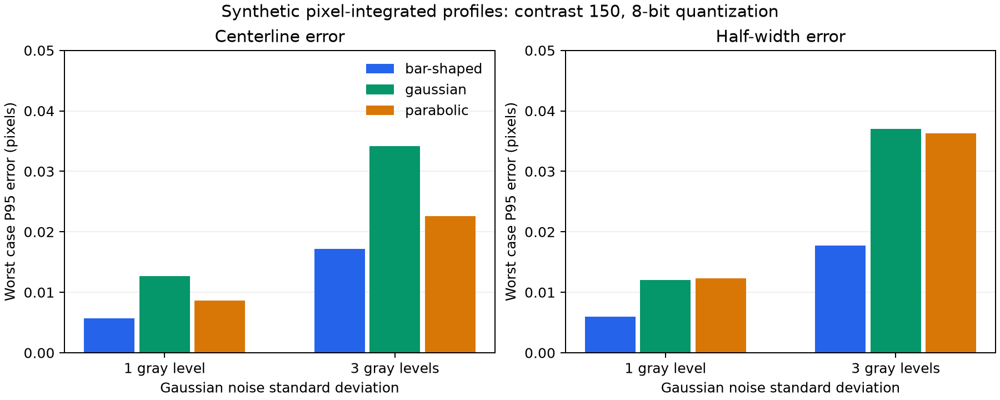
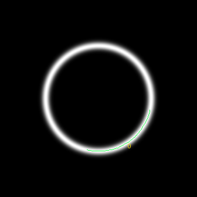

# Synthetic accuracy validation

Passed: **84/84** straight-line cases; circular neck: **True**.

These are independent geometric ground-truth tests on specified synthetic profiles. They are not tests on real sperm images, and they are not HALCON measurements.

| Noise standard deviation | Cases | Worst case P95 centerline error (px) | Worst case P95 half-width error (px) |
|---:|---:|---:|---:|
| 0 | 72 | 3.8319134e-05 | 0.00018772033 |
| 1 | 6 | 0.01266686 | 0.012334322 |
| 3 | 6 | 0.034181855 | 0.037037958 |

Contrast is 150 gray levels. Noisy cases include 8-bit rounding. Noiseless cases intentionally match the assumed profile model; near-zero errors demonstrate numerical consistency, not real-image metrology accuracy.

Circular neck: expected window direction difference 63.000000 degrees; measured 62.999477 degrees; absolute difference **0.000523 degrees**.

Source hash: `6b4f4b7b031c1a3dee2c259ad588cede38ccbd1b528dda0b5fdb1c380e536bda`.

The raw report retains every case, including pre-refinement errors, width errors, fit acceptance coverage, parameters, and execution time.

