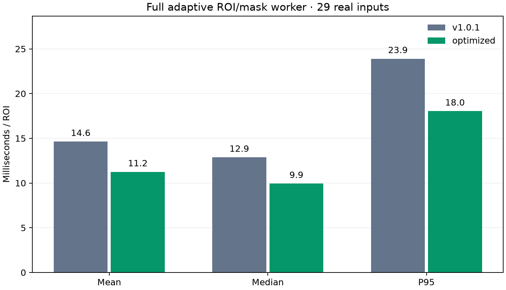

# ROI/mask worker optimization

Measured UTC: 2026-11-04T09:42:09.155455+00:00. Platform: macOS-13.0.1-arm64-arm-64bit.

Raw resident ROI/mask to angle+status; full adaptive search/rescue and quality checks; one persistent worker; interleaved randomized calls; no I/O, plots, queue wait or concurrent segmentation; warmed timings, not process startup.

Both versions receive the same **29 real ROI/mask pairs**; **26** return a full angle. Real images, per-image measurements and identities stay local.

| Version | Calls | Mean (ms) | Median (ms) | P95 (ms) | Maximum (ms) |
|---|---:|---:|---:|---:|---:|
| v1.0.1 | 870 | 14.637 | 12.874 | 23.903 | 39.857 |
| optimized | 870 | 11.247 | 9.946 | 18.036 | 26.851 |

Mean speedup: **1.30×**. These measurements describe this machine and dataset, not a latency guarantee for other images or concurrent workloads. Profiling was performed separately, outside the reported timing samples.

The optimized maximum is below the reference maximum in this run. The cause of individual latency fluctuations has not been isolated. Every sample is retained, without trimming or capping. This worker does not provide a hard real-time latency bound.

## Numerical equivalence

Reference commit: `914b3aed74b11b00b073491d6e3b91f471190853` (accepted v1.0.1). The tool loads its source from immutable Git objects under a separate package name.

Bitwise comparisons passed for 29 real inputs, 210 actual search candidate contours and 29 complete intermediate traces. They include coordinates, normals, responses, selected scale/polarity, fit diagnostics, quality flags and statuses. No tolerance was used to hide changed outputs.

Synthetic full-detector comparisons: 84 straight cases; 1 circle. Ground-truth acceptance is recorded separately in [the accuracy report](../accuracy-summary.md). Equivalence to v1.0.1 on tested inputs is distinct from real-image ground-truth accuracy.

Source SHA-256: `c78b5064d8293ed154d526aee1f1a5de39a77e27f882de5a45e0f2e44279f685`.

Input-array dataset SHA-256: `183ef8f8070a4d455ef5c8b617c7d3db5fc7960073f1b80130f6e0f380ee7e9d`.

## What changed

- Batch duplicate-neighbor queries for short necks, reuse each edge's norm/dot geometry for the two traversal directions, and preserve score ties and graph traversal order.
- Use the original unit-spacing gradient formulas for normal orientation without general N-D dispatch; retain the same norm/dot/arccos linking arithmetic and thresholds.
- Keep Taylor localization and candidate filtering in compact mask-selected arrays when trace capture is off. Full-ROI convolution, spline interpolation and full trace maps remain.

Float64, all five search scales, all three rescue scales, both polarities, Newton iteration rules, linking decisions, selection rules, end windows and quality gates are preserved. No new runtime dependency or compiled extension was introduced.

## First-call check

Each value below is one first computation in a separate fresh process on the first dataset input. Imports, file decoding and thread startup are outside the timer. These single samples are not steady-state means.

- v1.0.1: 21.755 ms.
- optimized: 17.540 ms.

The raw [aggregate JSON](optimization.json) retains environment details and separate profiler summaries. See [reproduction and API notes](../../docs/performance-followup.md).

## Independent repeat

A fresh process repeated the same real-input parity checks and timing. Source, dataset, environment and returned-angle count match the primary run. Synthetic comparisons are recorded in the primary run. The repeat does not replace or remove primary-run samples.

| Version | Calls | Mean (ms) | Median (ms) | P95 (ms) | Maximum (ms) |
|---|---:|---:|---:|---:|---:|
| v1.0.1 | 870 | 16.377 | 13.738 | 28.776 | 275.438 |
| optimized | 870 | 12.368 | 10.491 | 22.920 | 96.032 |

Repeat mean speedup: **1.32×**.
