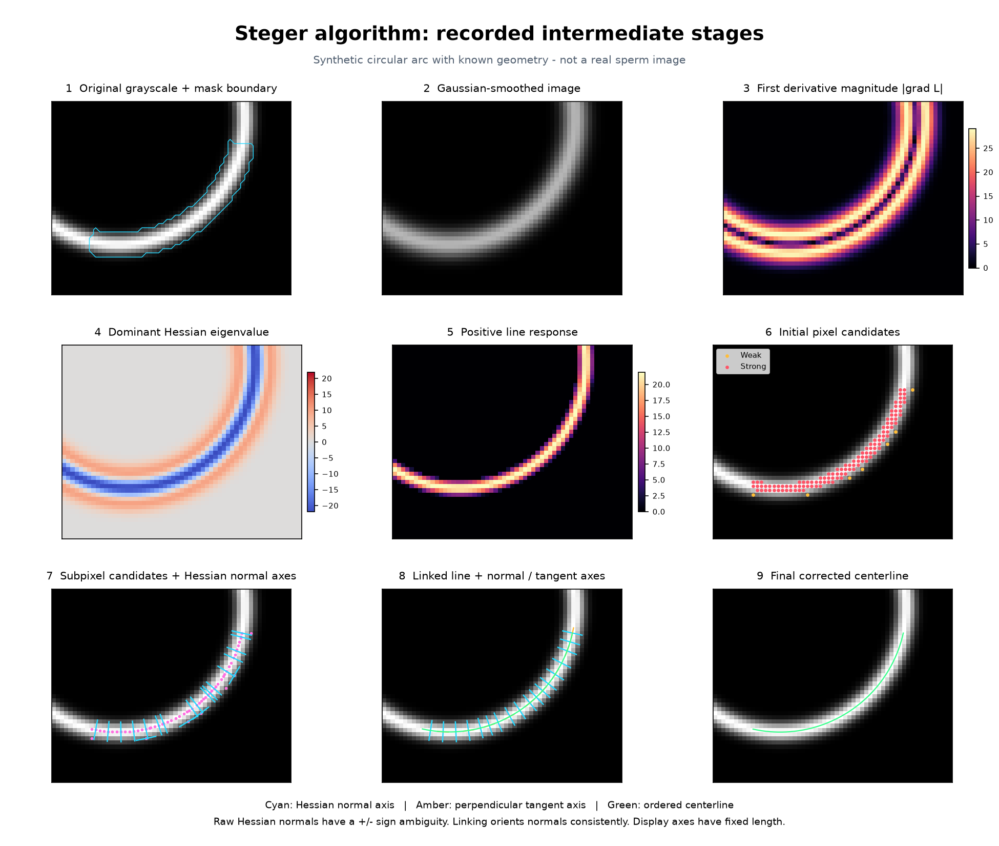
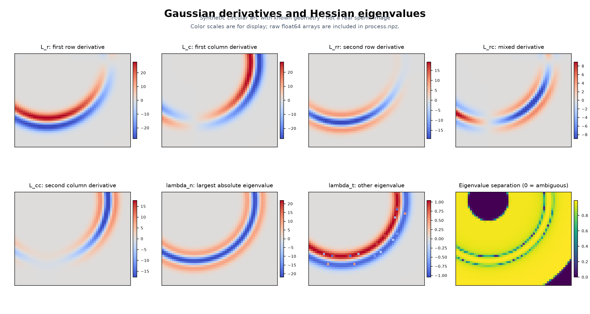
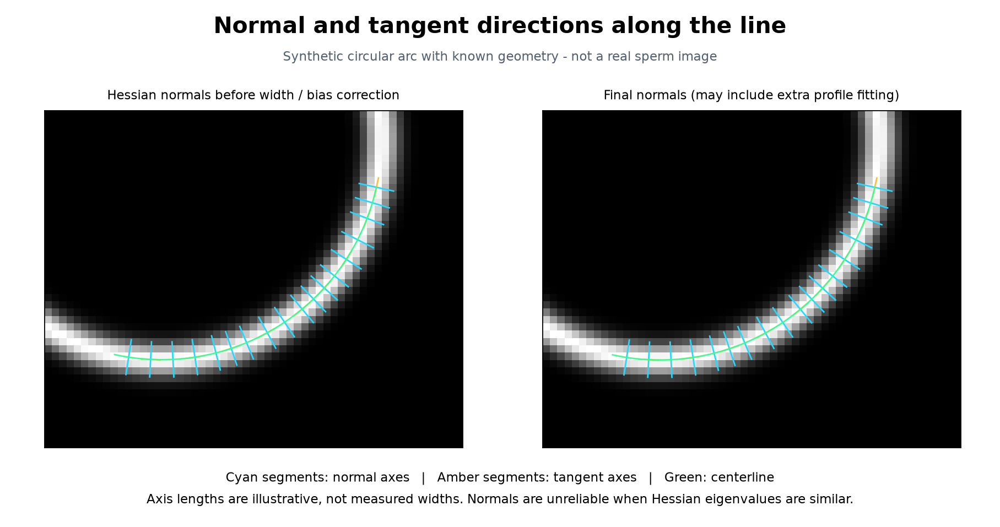
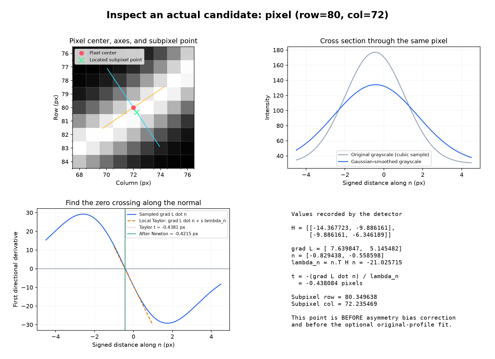

# Recorded Steger process

Synthetic circular arc with known geometry - not a real sperm image

Figures and arrays below come from the same detector invocation. Fixed-length cyan axes show normals; amber axes show tangents.

[Raw float64 arrays](process.npz) | [Parameters and point values](process.json)

Normals become ambiguous when the two Hessian eigenvalues have similar absolute magnitudes. A 90-degree rotation of a displayed normal gives its perpendicular tangent axis; it is not a separate curve fit.
